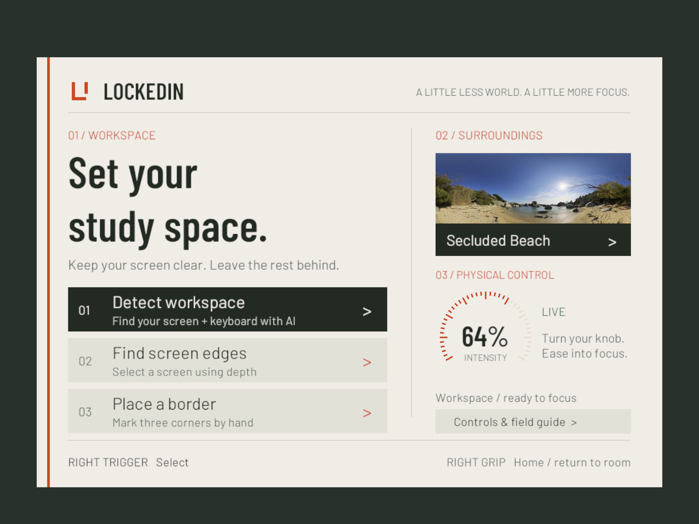
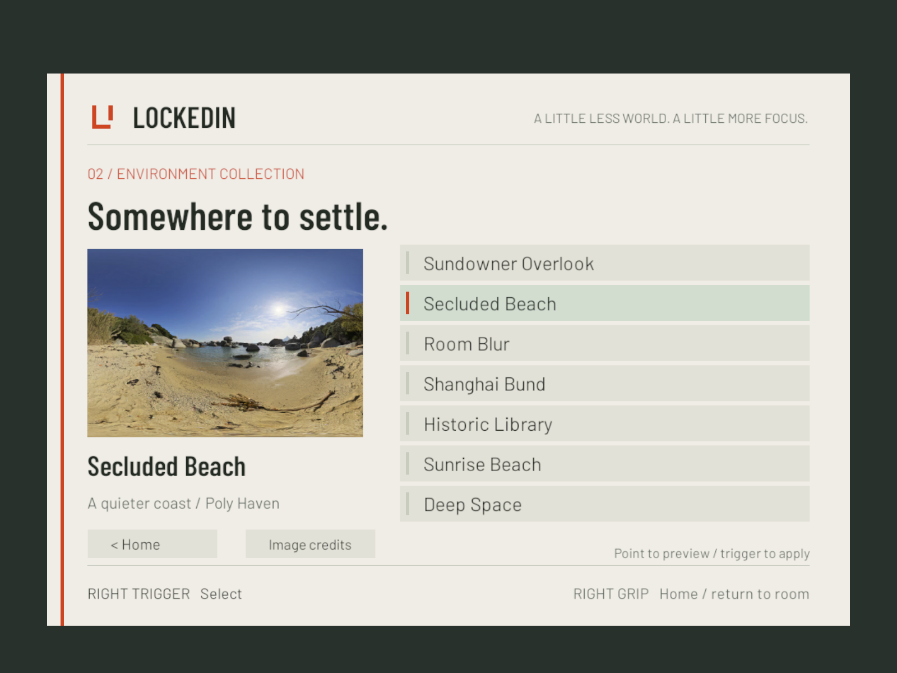
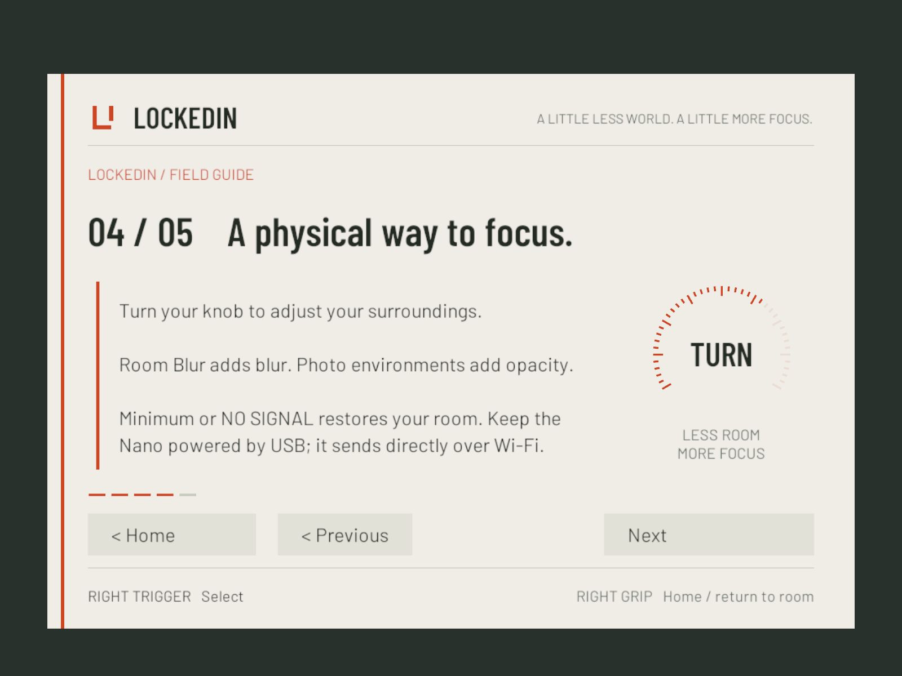

# LockedIn presentation interface

The in-headset console is redesigned as a quiet study instrument: warm paper, dark green ink, vermilion controls, Barlow body text and Barlow Condensed headings. The layout uses a printed spine, numbered sections, fine rules and photography rather than a dashboard of glowing cards. This is native Unity world-space UI, with no web view or additional UI framework.

## What changed

- **Home:** three distinct workspace actions, a photographic surroundings entry, a live potentiometer dial inside Home, actual workspace readiness and an always-accessible field guide.
- **Collection:** seven environments in a readable list. Pointing previews a location; the trigger applies it. A persistent selection rail marks the active environment. Room Blur has an intentionally typographic live-room preview.
- **Field guide:** five slides cover controller input, AI review, backgrounds, the physical knob and recalibration. AI, depth and manual placement each retain a separate explanation before starting. Credits are reachable from the collection.
- **During focus:** no floating percentage/status bar follows the user. Knob intensity and connection state remain available inside Home; calibration guidance appears only when needed.
- **Calibration:** a larger paper panel with an orange spine and clearly separated title/instructions carries the existing scan/retry/accept/manual prompts.
- **Interaction:** short hover color transitions, page fade-ins, pointer press feedback and subtle right-controller haptics when supported. There is no dwell activation. Input still uses the existing controller ray and trigger.

Detection, world-anchored clear regions, Nano UDP transport, watchdog clearing, camera/depth blur and panorama rendering retain their existing implementations. The redesigned labels route to the same callbacks. Signal state and percentage come from the live opacity controller; there are no invented timers or productivity scores.

## Assets and performance

The interface includes static Barlow Regular and Barlow Condensed SemiBold from the official Google Fonts repository, with their SIL OFL licenses under `Assets/Resources/LockedIn/Interface/Fonts`. Font sources: https://github.com/google/fonts/tree/main/ofl/barlow and https://github.com/google/fonts/tree/main/ofl/barlowcondensed.

Six small 512x256 PNG thumbnails are generated in the editor from the restored panorama assets. They use Android ASTC 6x6, no mipmaps or CPU readability. The interface loads only thumbnails; full panoramas still load one at a time through the existing renderer. Full sources and licenses, including the Library preview's CC BY-SA 4.0 attribution, remain in `Assets/Resources/LockedIn/Backgrounds/Credits.txt` and the in-app credits.

The vector knob face is ordinary UI geometry. Animation uses unscaled time and no new render textures at runtime. Thumbnail readback and screenshot rendering happen only in the editor. The presentation preview's sample 64% LIVE state is compiled out of the Quest build.

## Review and rebuild

1. Restore project assets with the existing restoration script if needed. Open Unity and choose **Assets > Refresh**.
2. **LockedIn > Interface > Generate environment previews** creates missing/outdated thumbnails. Generation also runs after imports.
3. **LockedIn > Interface > Capture presentation previews** writes Home, collection and knob-guide PNGs to `docs/previews`. It also exercises real ray hit-testing, all three detector callbacks, all seven background callbacks, credits navigation, all five tutorial slides, calibration/HUD visibility, Home reopening and outside-panel rejection. It uses a temporary camera and changes no saved scenes or tutorial preferences.
4. Open **File > Build Profiles**, keep `LockedInPassthrough` first, select the Quest and choose **Build And Run**.
5. On Quest, check text readability, controller hover/click response and grip reopening. Run AI detection and accept screen/keyboard boundaries. Try manual and depth modes. Select all environments and turn the Nano knob. Verify zero, unplugged Nano, bypass and Room Blur keep their established behavior.

## Rendered review screens

These are real Unity UI renders using an **editor-only sample 64% LIVE state**, rather than headset captures.

## Validation limits

`python tools/verify_workspace.py` compiles runtime, optional AI backend and editor source and checks geometry, opacity, UDP protocol and camera projection. It does not certify stereo readability, GPU cost or controller haptics on Quest. Native screenshots and the interaction fixture supplement those checks; an updated headset build still needs physical presentation rehearsal.
